# Codex Autopilot

**One next step for your whole account, fed by the whole Codex suite.** A single plaque in the game view, and a side panel, that always shows the one best thing to do right now, ranked across everything your account has going on, with a one-line reason. Full bird houses, herb runs, grown trees and special patches, diary dailies before the reset, the Kingdom of Miscellania and the goal you pinned in Codex Navigator all go into one order: what is about to go to waste first, then the chores that are ready, then your goal.

It is part of the **Codex** suite, after [Codex Navigator](https://github.com/Nubles/OSRS-Codex-Navigator), [Codex Rounds](https://github.com/Nubles/OSRS-Codex-Rounds), [Codex Bank Steward](https://github.com/Nubles/OSRS-Codex-Bank-Steward), [Codex Minigame Pilot](https://github.com/Nubles/OSRS-Codex-Minigame-Pilot) and the rest, and shares their look: warm ink, aged gold and the game's own fonts.

<p align="center">
  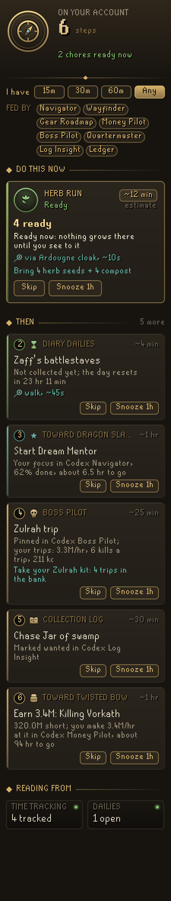
  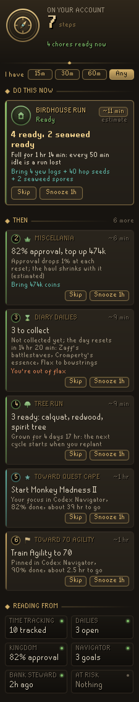
  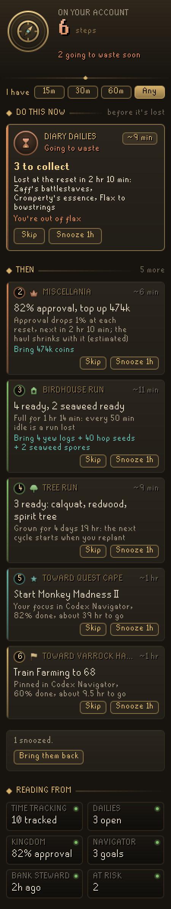
  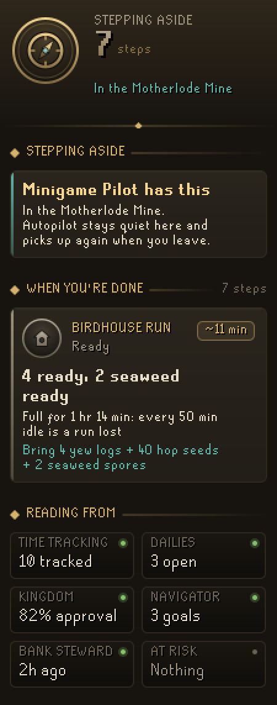
</p>
<p align="center">
  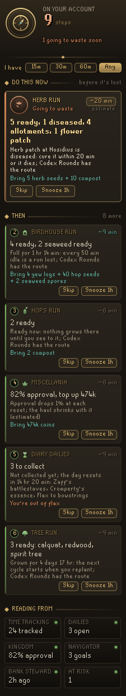
  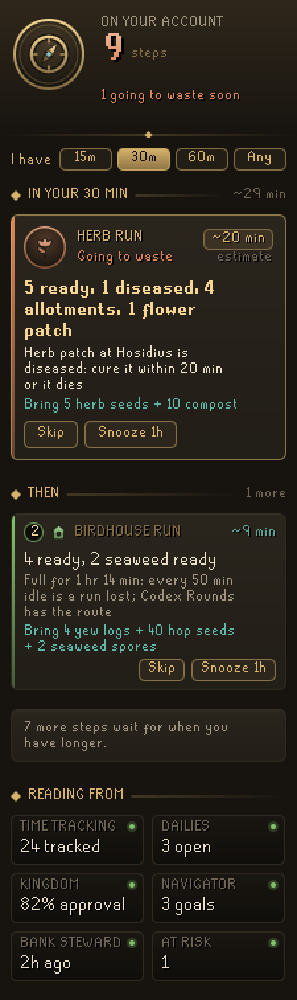
</p>

## The whole suite in one next step

Every Codex app you run shares a little of what it knows on your account, and Autopilot plans with all of it. No other plugin puts your travel, your money makers, your saving goal, your kits, your bosses and your collection log into one ordered list.

- **The way there, priced.** With Codex Wayfinder on, every step that happens somewhere (patches, bird houses, dailies, the kingdom, the farming contract) is priced with the teleports this account actually has, at Wayfinder's cast times and your own walking pace, plus the walk from where it lands, or the walk from where you stand. The step says how: "via Ardougne cloak, ~10s", "walk, ~45s", or "via Varrock Teleport (from the bank), ~2 min" when the teleport is banked. The step's time includes the journey.
- **Ties go to the closer step.** The order rule is unchanged: going to waste, then ready chores, then your focused goal, then other goals. Inside a band, steps are compared by what they save per minute *including the journey*, and what is still level goes to the step that is quicker to reach and do. The time budget counts the journey too.
- **Earn it for your goal.** When the upgrade Codex Gear Roadmap is saving toward costs more than the coins you hold (counted by Codex Ledger across every place it has seen, or Codex Bank Steward's bank), Autopilot offers "Earn 3.4M: Killing Vorkath": an hour's sitting of your best money maker, at the rate Codex Money Pilot clocked for you or the loot an hour of your Codex Boss Pilot trips, with how many hours are left. Ironmen are not offered it. Pieces you already hold are not counted; prices are today's.
- **Your pinned boss.** The boss pinned in Codex Boss Pilot is a step ("Zulrah trip"), timed at your average trip, with your loot an hour and kill count (the collection log's count from Codex Log Insight when it is newer), and the Codex Quartermaster kit for it: "Take your Zulrah kit: 4 trips in the bank", or "You're out of sharks for your Zulrah kit".
- **Restock.** When the kit you chose in Quartermaster has no trips left in the bank, a step says so and names the supply that ran out first.
- **Wanted slots.** The first collection log slot you marked wanted in Log Insight is a step: "Chase Jar of swamp".
- **Dailies while logged out.** The dailies Codex Rounds saw today fill in while the game cannot be read.
- **Fed by.** A small row of gilt pills at the top of the panel names every app whose data is in the plan right now.
- **Shared with Codex Home.** The top steps are saved for the other apps, so Codex Home's Today tab can show them.

Every app is optional and read only: a missing, switched-off or damaged save simply adds nothing, and each has its own switch under **Codex suite** in the settings.

<p align="center">
  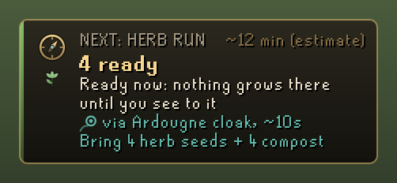
  <br>
  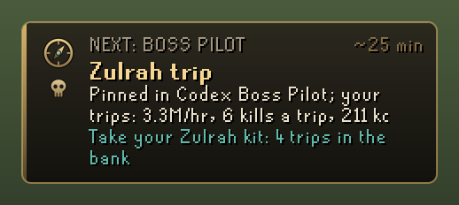
</p>

## Your Hunter rumour, in the same order

Inspired by the Hunter Rumours plugin, which a quarter of a million players use to keep track of their Hunter Guild rumour. Autopilot puts the rumour into the account's one order, so it is weighed against the bird houses, the dailies and your goals rather than living in an infobox of its own.

- **Finish it.** "Hunter rumour: Grey chinchompa for Cervus", with where it is hunted and how likely the rare part is: "Box traps at Piscatoris, Kourend Woodland or Isle of Souls; the part is 1 in 50 a catch, sure by 100", and what to bring. With Codex Wayfinder on, the journey is priced to the nearest of those places ("via Fairy ring AKQ, ~40s").
- **Take the part back.** Once "You find a rare piece of the creature!" shows, the step becomes a quick ready errand: "Take the part back to Teco", with the reward ("Teco pays 4,345 Hunter xp and an expert loot sack") and the milestone it reaches ("your 50th unlocks cooking the antelopes and dashing kebbit").
- **Get the next one.** With no rumour in hand, an account that does rumours (one has been seen or counted) is offered the best tier its Hunter level opens: "New rumour from Aco or Teco" at 72, Wolf at 91 once At First Light is done.
- **Your own pace.** A rumour is timed from being given to the rare part, counting only time logged in; after three of a hunting method the step shows your time ("~27 min (your pace)") instead of the half-hour estimate.
- **Rumours started elsewhere.** Until Autopilot has heard a rumour itself, it plans with the one the Hunter Rumours plugin saved, and says so ("as Hunter Rumours saved it").

There is no varbit for the rumour, so it is read from what the game says: a guild hunter naming a creature (or another hunter's: "I hear you're hunting for Teco."), the quetzal whistle's "Your current rumour target is ...", the rare part, the hand-in and "You have completed N rumours for the Hunter Guild." It never goes to waste, so it is ranked with the goals; the rare part waiting to go back sits with the ready chores. **Hunter rumours** under Sources switches it off.

<p align="center">
  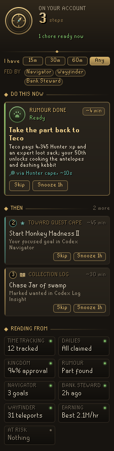
  <br>
  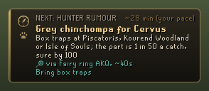
</p>

## Your port tasks, as one voyage

Inspired by the Port Tasks plugin, which a quarter of a million players use to find their way between ports. Autopilot plans the tasks in your slots as one voyage and puts it in the account's one order, beside the bird houses, the dailies and your goals.

- **One voyage, the fewest stops.** Every courier task in hand is planned together: collect each task's crates at its ledger table, then deliver them, with every port called at once for everything it can do. Two tasks bound for the same port share the stop; cargo waiting where another is delivered is collected on the same call. The step is the next stop ("Deliver platebodies, collect spices at The Pandemonium") with the whole route ("Musa Point → The Pandemonium → Port Sarim: 3 tasks, 3 stops").
- **Crates aboard come first.** The game loses crates in the hold if you die, capsize or teleport off the boat at sea, so once a crate is taken, finishing the voyage is a ready errand rather than a goal, and the step says how many crates are at risk.
- **Bounties.** "Albatross beak, 3 of 5", counted from the game; once all are in hand, "Claim the albatross beak bounty" at any port master.
- **More tasks where you end up.** With slots open, the voyage says "then take 2 more tasks at The Pandemonium's notice board, where it ends" when that port has one; with no voyage under way, "Take 3 more port tasks" is a step of its own.
- **Your own pay, never a guess.** When a slot empties as Sailing xp arrives, Autopilot notes what that task paid, and shows it next time ("they paid you 322 Sailing xp last time"). A task you have not handed in shows no xp rather than a figure that may be out of date.
- **The chart in the panel.** A Voyage section draws the stops down a gilt rail, the next one lit, and a Port tasks section lists every task, where it goes, how far along it is and the slots in use.

Everything about a task (its name, ports, cargo and amount, or the bounty's creature, part and count) is read from the game's own port task and docking point tables, and its progress from the task slots' varbits, so tasks added or changed by an update read as the game has them. It is saved for while you are logged out. **Sailing port tasks** under Sources switches it off.

<p align="center">
  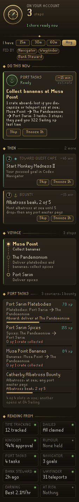
  <br>
  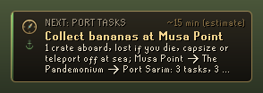
</p>

## Your kitten, before it runs off

Inspired by the Kitten Tracker plugin, which some 165,000 players have installed to keep their kitten fed, stroked and growing. Autopilot puts the kitten into the account's one order, so a meal that is due is the next step, ahead of a bird house run, rather than a timer in a corner.

- **Fed and stroked in time.** "Feed your kitten" turns up five minutes before it should get hungry, as a ready step that fits into the trip already being made, and goes to waste once the game says it is hungry, with the minutes left before it runs off ("It is hungry: it runs off in about 6 min unless fed"). The same for attention, with the tip that stroking twice buys 25 minutes and a ball of wool 51. Both at once are one step.
- **Times learned from the game.** Every hunger or attention warning is the measure of how long the last meal or stroke really lasted. Until three are heard the wiki's times are used (24 minutes to hunger; 25 for a new kitten, 18 for one stroke, 25 for more, 51 for wool), and the step says whose time it is.
- **Only while it follows.** The clock runs only while your kitten follows you, as the game's own does: picked up, banked or logged out, its needs wait and nothing nags. Another player's kitten nearby is never taken for yours; the follower is RuneLite's own.
- **Kept per account.** Saved with this account's settings (`codexautopilot/kittenV1`), so a logout, a world hop or switching accounts loses nothing.
- **Growth.** The panel's Kitten section shows food, attention and growth as bars; "Guess age" in game sets the growth clock right. When it grows into a cat Autopilot tells you once and stops asking, and shows when it will turn overgrown (another five to six hours of following).

What it reads is the game's own: the follower's npc id (kitten, cat or overgrown cat), the kitten in your inventory, and the lines the wiki records ("The kitten gobbles up the fish.", "Your kitten is hungry.", "You softly stroke your cat.", "Your kitten has grown into a healthy cat that can hunt for itself." and the rest). **Pet kitten** under Sources switches it off.

<p align="center">
  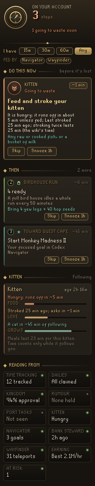
  <br>
  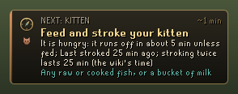
</p>

## Your Slayer task, with where to go and your own pace

Inspired by RuneLite's Slayer plugin and the Plugin Hub's Slayer assistants, which show the task, how many are left and where to go. Autopilot puts the task into the account's one order and goes further: it times the task at your own kills an hour and tells you which master to ask next.

- **The task, where and what to bring.** "Slayer task: Kurask, 87 left", with where they live ("Fremennik Slayer Dungeon, Iorwerth Dungeon or Kurask Lair") and what the fight needs ("Leaf-bladed weapons, broad ammunition or Magic Dart: nothing else hurts them"). With Konar, the area she sent you to, as the game names it. With Codex Wayfinder on, the journey is priced to the nearest of those places.
- **Your own pace.** Every kill is timed from the one before it; a gap of more than five minutes (a bank trip, a break, a logout) is left out, so the rate is your kills an hour while on task. It is kept per task, for this account, and once twenty kills are timed the step says "~44 min (your pace)" and "at your 120 kills/hr".
- **The next master.** Once the task is done: "New task from Duradel", the most demanding master your combat level, Slayer level and quests open, with what your next task in a row pays there ("your 10th in a row pays 75 points (5x); Konar pays 90"), or how many tasks until points start. Aya, Steve and Kuradal are named once the quest that brings them is done; the Western Provinces and Kourend & Kebos elite diaries raise Nieve's and Konar's points.
- **The panel.** A Slayer section shows the tally slain, where, what to bring, your pace, the next master and your points and streak.
- **Your streak and what it pays.** The streak on a track to its next 50th, a tick on every 10th with its multiplier, and what your next task in a row pays with each master open to you ("Konar 270, Duradel 225, Nieve 180 ... Turael 0" on a 50th).
- **Your own points an hour.** Each finished task is kept with who gave it, the points it paid and the logged-in time it took, so the panel shows your own Slayer points an hour and your minutes a task with each master.
- **The skip plan (off by default).** Inspired by the Plugin Hub's Turael Skipping and Konar Milestone Reminder. Switch on **Slayer skip plan** under Priorities, pick the **Milestone master** (or the best open to you) and whether **Milestones** are every 10th or every 50th task. Between tasks the step becomes "Quick task from Turael or Spria" (their tasks pay no points but still count toward the streak) until the next milestone is due, then "Milestone task from Konar" with what it pays. While you hold a task from another master it says to finish it: a task change at Turael resets the streak to zero. With your own times for both, it shows what skipping earns an hour against doing every task with your milestone master over the same run of tasks.

Where and what to bring are written in only for the tasks checked against the OSRS wiki (rockslugs, lizards, banshees, cockatrice, harpie bug swarms, wall beasts, killerwatts, molanisks, basilisks, fever spiders, turoth, mutated zygomites, cave horrors, aberrant spectres, wyrms, dust devils, kurask, gargoyles, drakes, smoke devils and hydras); any other task shows its count, master and pace without a guess. The task, the amount, Konar's area, the master, the points and the streaks are read from the game's own values and tables, the way RuneLite's Slayer plugin reads them, and saved for while you are logged out. It never gives in-fight cues. **Slayer task** under Sources switches it off.

<p align="center">
  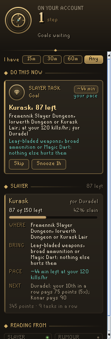
  <br>
  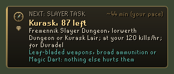
  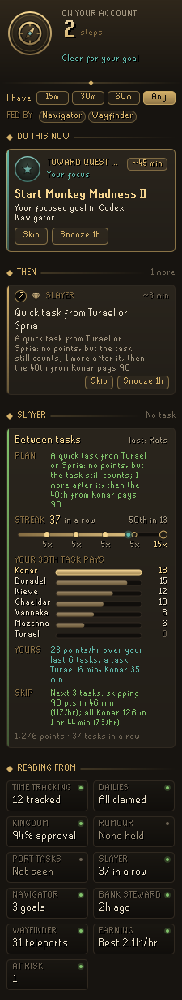
</p>

## The Gemstone Crab, with its clock, its shell and where it went

Inspired by the Plugin Hub's Gemstone Crab plugins, which time the crab, highlight the cave and count your gems for the session. Autopilot puts the crab into the account's one order while you stand at one of its mines, and keeps what it learns for the account rather than the session.

- **Its clock.** "Gemstone Crab: North mine, ~6 min left". The crab's bar is not moved by anyone's damage; it drains to show when the crab burrows (OSRS wiki). Autopilot times that fall on the crab in front of you, and before it has fallen far enough to tell, uses your own timed crabs, or else the wiki's "approximately every 10 minutes", marked "(est.)".
- **Its shell.** When the game says "You gained enough understanding of the crab to mine from its remains.", the step turns to "Mine its shell, 3 gems" with the seconds of its 90 left, and counts the gems down as you mine them. A shell that was not yours is counted, never offered.
- **Where it went.** The wiki gives no order to its moves, so Autopilot learns one from your own sightings: where it burrowed and where you next saw it, within eight minutes. Once three moves from a mine agree, the step names the next mine ("Follow it to the south-west mine; 3 of 3 moves you saw from the east mine went there") and Codex Wayfinder prices the way there; until then it says the cave at every mine leads to the crab and prices the nearer of the other two.
- **Your own rates.** Combat xp gained and gems mined while at the crab, over the time spent there, for this account: "your 137k xp/hr, 17 gems/hr here", with each gem tallied in the panel.

It reads the crab's npc and its health bar, where you stand, your combat xp and the game's own lines about the crab; it never gives in-fight cues. **Gemstone Crab** under Sources switches it off.

<p align="center">
  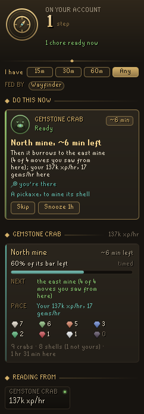
  <br>
  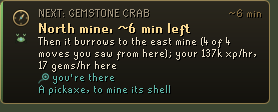
</p>

## What it does

- **One step, always.** The plaque shows the best next step in gilt letters, what kind of step it is, about how long it takes, why it is first, and what to bring. Its edge takes the step's colour: ember when something is about to be lost, green for a ready chore, teal for your focused goal.
- **Time-aware.** Steps are ordered by what waiting costs. A daily you have not collected is lost at midnight UTC, so in the last hours before the reset it jumps to the front. A diseased patch dies at its next growth tick. The kingdom's approval and coffer drop at every reset. A full bird house idles a whole run every 50 minutes, a grown calquat only a sliver of its day-long growth, so the Fossil Island trip comes before the tree run.
- **Chores that fit together.** Ready things are grouped into the trips you would actually make: "Birdhouse run: 4 ready, 2 seaweed ready" (with Fossil Island's hardwoods), a tree run, and the special patches. If more join within a quarter of an hour the step says so.
- **Herb and hops runs.** Your herb patches become one step, "Herb run: 5 ready, 1 diseased, 4 allotments", with the allotments and flower patches beside them riding along, and the hops patches have a run of their own. A diseased patch dies at its next growth tick and a dead herb patch grows nothing, so either puts the run among the things going to waste. Only patches you actually farm count: weeds, bare soil, scarecrows and patches dead for days are left alone, and a lone flower patch is not worth a trip on its own. The bring line counts herb seeds (any kind) and compost (or your bottomless bucket) against the bank.
- **Heads-up notifications.** Through RuneLite's own notifier, once when something starts going to waste and once when a chore trip becomes ready ("Bird houses are full"). Each step is told about once; it is told again only when it changes, such as falling diseased after it was ready, or coming ready again after you did it. Logging in does not replay what was already waiting. Each kind has its own switch.
- **Your own pace.** Times are estimates until Autopilot has seen you do a kind of run three times; then they are yours: "~9 min (your pace)" instead of "~11 min (estimate)". A run is timed from the first stop you finish (a house reset, a patch replanted) to the last, so a run left waiting for an hour does not count as an hour's work, and it is only learned from when it was the step at the top. The middle of your last seven runs is used, and a run interrupted by logging out is dropped.
- **Time budget.** "I have 15 / 30 / 60 min / any" at the top of the panel. With a limit, the panel shows the best set of steps that fits, with the total time: anything going to waste first, then what saves most per minute. The plaque shows the first of them.
- **Hand-off to Codex Rounds.** With Codex Rounds on, bird house, tree and special patch steps say "Codex Rounds has the route", and Rounds walks you round. Herb and hops runs are not on its round.
- **Your goal, next.** The focused goal on your Codex Navigator board becomes a step ("Toward Quest cape: Start Monkey Madness II"), followed by your other pinned goals, those with least left first. **Goal first** in the settings lets your focused goal pass slow chores such as trees, dailies with hours to spare and the kingdom; full bird houses and anything about to go to waste still come first.
- **What to bring.** If Codex Bank Steward has seen your bank, the step checks it: "Bring 4 yew logs + 40 hop seeds + 2 seaweed spores", or "You're out of flax" before you set off.
- **The next five.** The panel lists the five steps after the first, each with why it is there and how long it takes. **Skip** moves a step to the end for this session; **Snooze 1h** hides it for an hour. **Bring them back** undoes both.
- **Steps aside.** In the Motherlode Mine, at the Blast Furnace or on a Mahogany Homes contract, where Codex Minigame Pilot guides, the plaque goes away and the panel says so. It comes back when you leave.
- **Quiet mode.** Only show what is about to go to waste, and nothing else.
- **Nothing pinned, nothing ready.** The panel says what comes ready next, such as "Bird houses full in 23 min".

<p align="center">
  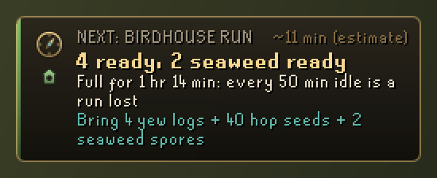
  <br>
  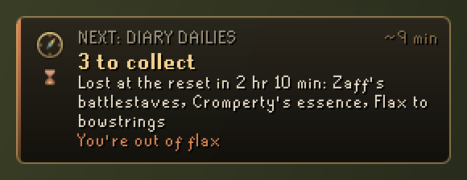
  <br>
  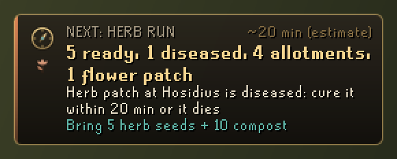
  <br>
  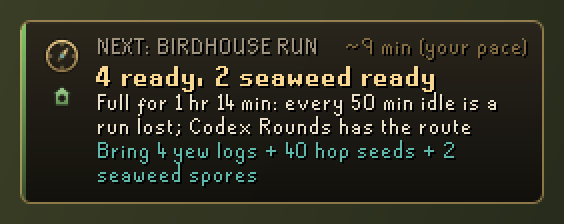
</p>

## Where it reads from

Everything is read on your computer, from the client and from RuneLite's saved profile data, and nothing is changed:

- **RuneLite's Time Tracking plugin**: the bird houses, seaweed, hardwood, special trees, spirit trees, special patches, herbs, allotments, flowers and hops it has seen, with growth predicted the same way as Codex Rounds (including your farming tick offset). Patches left to weeds and empty bird house spaces are not nagged about.
- **RuneLite's Kingdom of Miscellania plugin**: approval and coffer as last seen, carried forward a day at a time.
- **The game**: diary dailies and the farming contract, read live while you are logged in.
- **Codex Navigator**: the goal board it saves for companion plugins.
- **Codex Bank Steward**: the bank it last saw, only to check a chore's supplies.
- **Codex Wayfinder**: the travel atlas it shares (`codexwayfinder/atlasV1`): your teleports, where each lands and how long it takes, and your walking pace.
- **Codex Money Pilot**: the money making runs it clocked (`codexmoneypilot/runs`), at your own rate over the last 60 days.
- **Codex Gear Roadmap**: the upgrade you are saving toward (`codexgearroadmap/goal`).
- **Codex Ledger**: your coins, what you hold and its prices (`codexledger/ledger`), read about once a minute.
- **Codex Quartermaster**: your kits and the trips your bank covers (`codexquartermaster/kitsV1`).
- **Hunter Rumours** (another author's plugin): the rumour it saved (`hunterrumours/current.hunter`, `hunter.<npc id>`, `current.rumour.finished`), only until Autopilot has read one itself.
- **RuneLite's chat commands plugin**: the rumour count it keeps (`killcount/hunter rumours`), until Autopilot hears the count itself.
- **Codex Boss Pilot**: the boss you pinned and your logged trips (`codexbosspilot/pinned`, `logbookV1`).
- **Codex Rounds**: the dailies it saw today (`codexrounds/memory`), only while you are logged out.
- **Codex Log Insight**: the slots you marked wanted and the log's kill counts (`codexloginsight/progress`).

Several of these are the other app's own save rather than a published contract; Autopilot's tests pin the exact shape it reads, so a change on either side is caught.

Every source is optional. Bird houses and the special patches, herb runs and hops runs each have their own switch. Without Navigator there are no goal steps; without Bank Steward the bring line is a plain list. Each can be switched off in the settings.

## Rules posture

Codex Autopilot only reads what the game and RuneLite already know and draws a plaque and a panel. It does not click, type, change menus or menu entries, give boss or combat cues, read or write files (apart from the optional field notes below), or send anything over the network. Its notifications go through RuneLite's own notifier, on your computer. The only thing it saves is its own settings, including your learned pace (a few numbers per kind of run, kept with the rest of the plugin's settings for that account), your Hunter rumour as it last read it (`codexautopilot/rumourV1`; it reads game messages and the guild hunters' lines only, never other players' chat), your kitten as it last saw it (`codexautopilot/kittenV1`), your Slayer task, kill pace and recent finished tasks (`codexautopilot/slayerV1`), your time, xp and gems at the Gemstone Crab and the moves you saw it make (`codexautopilot/gemstoneCrabV1`) and its top steps for the other Codex apps (`codexautopilot/planV1`, switch off with **Share the plan**). It never writes another plugin's data.

## Field notes

An optional setting, **Keep field notes** (under Field notes, off by default), writes a plain record of what Autopilot reads and decides to its own folder in `.runelite/plugin-data` on your computer, one line at a time. It is for checking the plugin's guesses against real play: when something looks wrong, the notes show what it saw and why it chose what it did. Other players' chat is never written down, it stays on your computer, and nothing is sent anywhere.

## Development

```bash
./gradlew build   # compile and run tests
./gradlew run     # launch RuneLite with the plugin loaded
```

The readers and the ranking (`core/`) are plain Java with unit tests; the panel and plaque are in `ui/` and `overlay/`.

## Licence

BSD 2-Clause, see [LICENSE](LICENSE).
