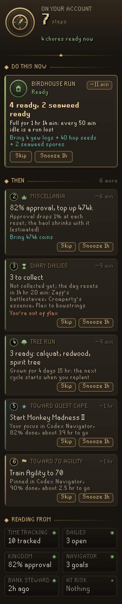
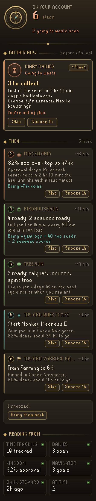
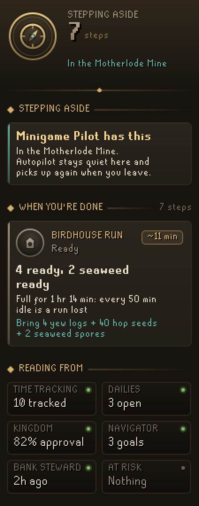
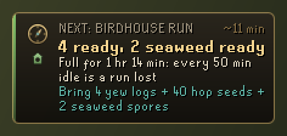
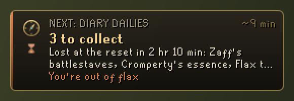

# Codex Autopilot

**One next step for your whole account.** A single plaque in the game view, and a side panel, that always shows the one best thing to do right now, ranked across everything your account has going on, with a one-line reason. Full bird houses, grown trees and special patches, diary dailies before the reset, the Kingdom of Miscellania and the goal you pinned in Codex Navigator all go into one order: what is about to go to waste first, then the chores that are ready, then your goal.

It is part of the **Codex** suite, after [Codex Navigator](https://github.com/Nubles/OSRS-Codex-Navigator), [Codex Rounds](https://github.com/Nubles/OSRS-Codex-Rounds), [Codex Bank Steward](https://github.com/Nubles/OSRS-Codex-Bank-Steward), [Codex Minigame Pilot](https://github.com/Nubles/OSRS-Codex-Minigame-Pilot) and the rest, and shares their look: warm ink, aged gold and the game's own fonts.

<p align="center">
  
  
  
</p>

## What it does

- **One step, always.** The plaque shows the best next step in gilt letters, what kind of step it is, about how long it takes, why it is first, and what to bring. Its edge takes the step's colour: ember when something is about to be lost, green for a ready chore, teal for your focused goal.
- **Time-aware.** Steps are ordered by what waiting costs. A daily you have not collected is lost at midnight UTC, so in the last hours before the reset it jumps to the front. A diseased patch dies at its next growth tick. The kingdom's approval and coffer drop at every reset. A full bird house idles a whole run every 50 minutes, a grown calquat only a sliver of its day-long growth, so the Fossil Island trip comes before the tree run.
- **Chores that fit together.** Ready things are grouped into the trips you would actually make: "Birdhouse run: 4 ready, 2 seaweed ready" (with Fossil Island's hardwoods), a tree run, and the special patches. If more join within a quarter of an hour the step says so.
- **Your goal, next.** The focused goal on your Codex Navigator board becomes a step ("Toward Quest cape: Start Monkey Madness II"), followed by your other pinned goals, those with least left first. **Goal first** in the settings lets your focused goal pass slow chores such as trees, dailies with hours to spare and the kingdom; full bird houses and anything about to go to waste still come first.
- **What to bring.** If Codex Bank Steward has seen your bank, the step checks it: "Bring 4 yew logs + 40 hop seeds + 2 seaweed spores", or "You're out of flax" before you set off.
- **The next five.** The panel lists the five steps after the first, each with why it is there and how long it takes. **Skip** moves a step to the end for this session; **Snooze 1h** hides it for an hour. **Bring them back** undoes both.
- **Steps aside.** In the Motherlode Mine, at the Blast Furnace or on a Mahogany Homes contract, where Codex Minigame Pilot guides, the plaque goes away and the panel says so. It comes back when you leave.
- **Quiet mode.** Only show what is about to go to waste, and nothing else.
- **Nothing pinned, nothing ready.** The panel says what comes ready next, such as "Bird houses full in 23 min".

<p align="center">
  
  <br>
  
</p>

## Where it reads from

Everything is read on your computer, from the client and from RuneLite's saved profile data, and nothing is changed:

- **RuneLite's Time Tracking plugin**: the bird houses, seaweed, hardwood, special trees, spirit trees and special patches it has seen, with growth predicted the same way as Codex Rounds (including your farming tick offset). Patches left to weeds and empty bird house spaces are not nagged about.
- **RuneLite's Kingdom of Miscellania plugin**: approval and coffer as last seen, carried forward a day at a time.
- **The game**: diary dailies and the farming contract, read live while you are logged in.
- **Codex Navigator**: the goal board it saves for companion plugins.
- **Codex Bank Steward**: the bank it last saw, only to check a chore's supplies.

Every source is optional. Without Navigator there are no goal steps; without Bank Steward the bring line is a plain list. Each can be switched off in the settings.

## Rules posture

Codex Autopilot only reads what the game and RuneLite already know and draws a plaque and a panel. It does not click, type, change menus or menu entries, give boss or combat cues, or send anything over the network. It never writes another plugin's data.

## Development

```bash
./gradlew build   # compile and run tests
./gradlew run     # launch RuneLite with the plugin loaded
```

The readers and the ranking (`core/`) are plain Java with unit tests; the panel and plaque are in `ui/` and `overlay/`.

## Licence

BSD 2-Clause, see [LICENSE](LICENSE).
